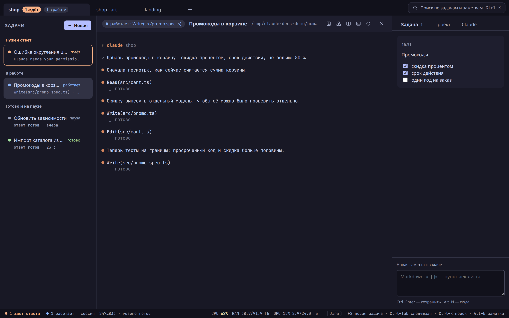
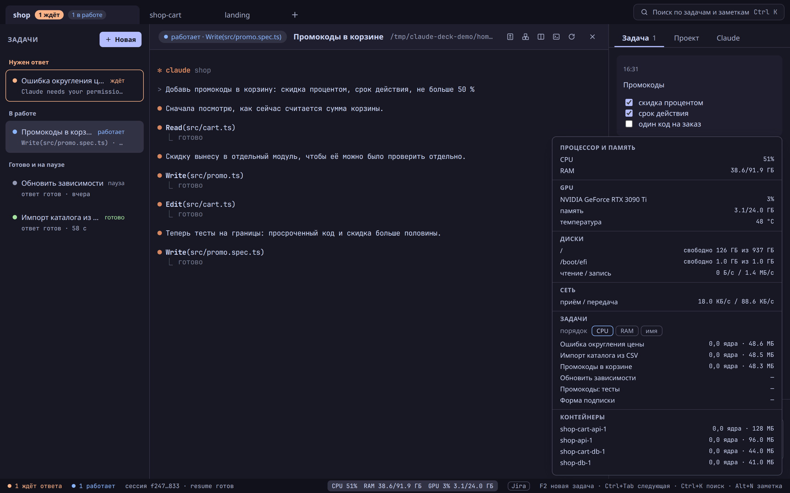
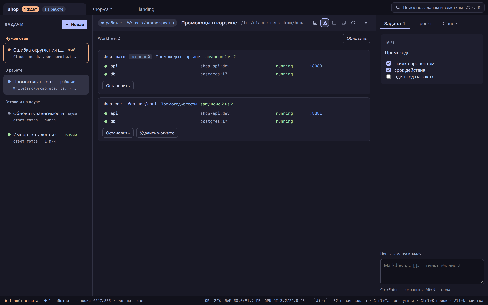
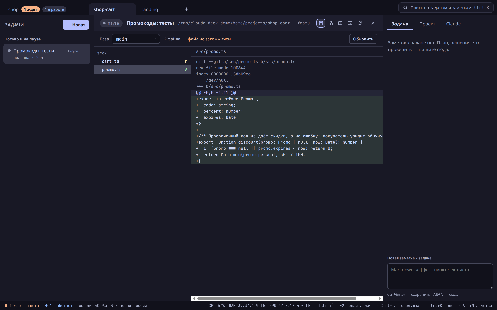
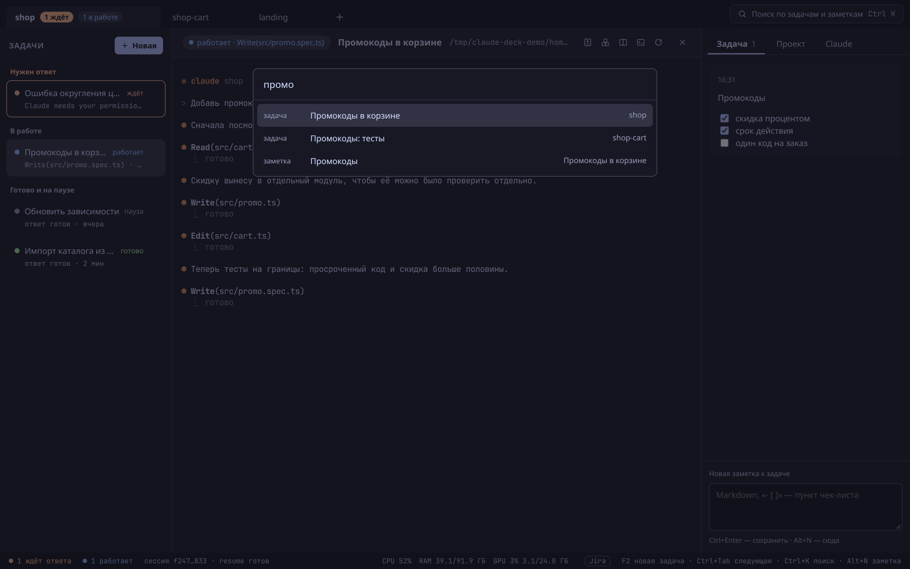

# Claude Deck

Настольное приложение для Ubuntu, в котором удобно вести сразу несколько сессий
[Claude Code](https://docs.claude.com/claude-code): каждая задача — своя сессия
`claude`, а приложение показывает, какая из них работает, какая ждёт вашего
ответа и какая уже закончила.



## Что умеет

- **Проекты в табах.** Каждый каталог — таб сверху; на табе видно, сколько задач
  в нём ждёт ответа и сколько работает. `Ctrl+1…9` — переход к проекту.
- **Задачи со статусом в реальном времени.** Слева — задачи проекта: «ждёт»
  (claude спрашивает разрешение или ответа), «работает» — с тем, что он делает
  прямо сейчас, «готово» и «пауза». Статус приходит из хуков Claude Code, а не
  угадывается по выводу.
- **Переключение клавишами.** `Ctrl+Tab` — следующая задача, `F2` — новая,
  `Ctrl+K` — поиск по задачам и заметкам, `Alt+N` — заметка. Подсказки — в строке
  состояния.
- **Заметки.** К задаче и к проекту, в Markdown, с чек-листами.
- **Изменения относительно базы.** Дерево изменённых файлов и diff ветки против
  `main` (или выбранной базы), вместе с незакоммиченным.
- **Worktree и окружения.** Worktree проекта, контейнеры docker compose под каждым
  из них, их порты и логи; остановка окружения и удаление worktree.
- **Потребляемые ресурсы.** Процессор, память, видеокарта и диск машины, нагрузка
  каждой задачи и каждого контейнера.
- **Обновление кнопкой.** Вышла новая версия — в строке состояния появляется
  «Обновить до x.y.z».









## Что нужно

- Ubuntu 24.04 или новее, x86_64.
- `claude` (Claude Code) в `PATH` — приложение запускает его для каждой задачи.
- `node` 22 или новее — на нём работают хуки и MCP-сервер приложения.
- FUSE 3 — на нём работает AppImage: `sudo apt install fuse3`.

Чего не хватает, установка скажет одним списком и ничего не поставит.

## Установка

```bash
curl -fsSL https://github.com/olegsv3007/claude-deck/releases/latest/download/install.sh | bash
```

Установка кладёт приложение в `~/.local/bin/claude-deck.AppImage`, а ярлык
«Claude Deck» — в меню приложений. На Ubuntu она один раз попросит пароль `sudo`:
нужен профиль AppArmor `claude-deck-appimage`, без которого песочница окна не
запускается. Повторный запуск той же команды ставит последнюю версию поверх.

## Обновление

Приложение раз в 6 часов проверяет релизы. Когда есть новая версия, в строке
состояния появляется кнопка «Обновить до x.y.z»: она скачивает новую версию,
сверяет контрольную сумму, заменяет файл и перезапускает приложение. Открытые
сессии закрываются, как при обычном выходе; задачи, заметки и продолжение
сессий остаются.

## Данные

Проекты, задачи, заметки и настройки — в `~/.config/claude-deck`. Сессии
`claude` лежат там же, где всегда, — в `~/.claude`.

## Удаление

```bash
rm -f ~/.local/bin/claude-deck.AppImage \
  ~/.local/share/applications/claude-deck.desktop \
  ~/.local/share/icons/hicolor/512x512/apps/claude-deck.png
# профиль AppArmor, если ставился: выгрузить и удалить
sudo apparmor_parser -R /etc/apparmor.d/claude-deck-appimage
sudo rm -f /etc/apparmor.d/claude-deck-appimage
# данные — только если они больше не нужны
rm -rf ~/.config/claude-deck
```
